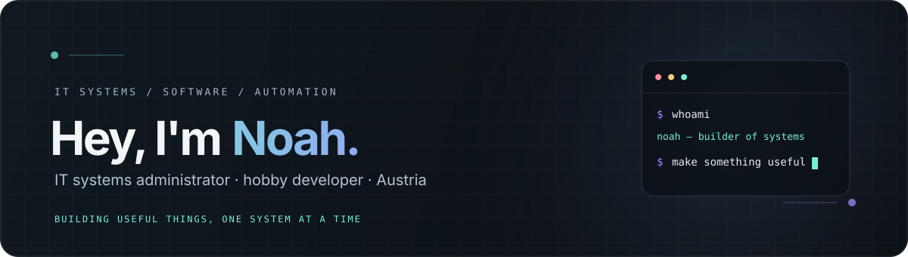

  

  

    
    
    
  

 

## A little about me

I'm Noah, an IT systems administrator and hobby developer from Austria. I enjoy building systems, websites, and small tools—with a focus on clean technology and a clear experience for the people using them.

My favorite work happens where **systems administration, automation, and development** meet.

## On my workbench

### [Security Maid](https://github.com/xjustanoah/securitymaid)

A security-focused Discord bot I'm building. Contributions and ideas are welcome!

  

## Tools in my toolbox

  
   
  
   
  

## A few GitHub stats

  
  

 

  <a href="https://www.instagram.com/xjustnoah">Instagram</a>
  &nbsp;·&nbsp;
  <a href="https://noah-muxxle.dev">Website</a>
  &nbsp;·&nbsp;
  <a href="https://discord.gg/muxxle">Discord</a>

  

